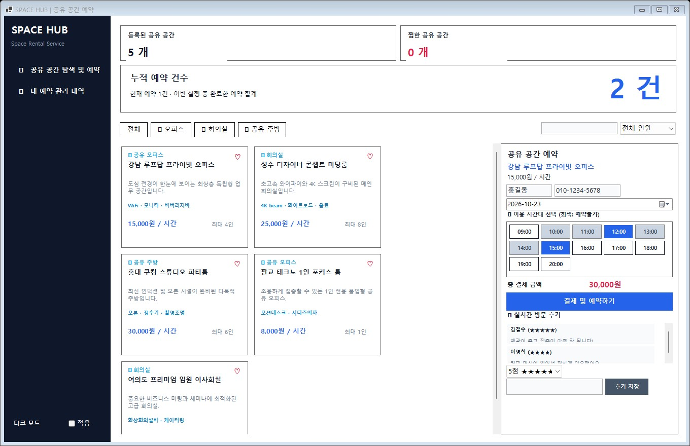
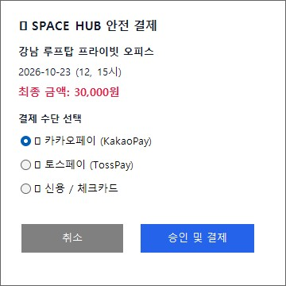
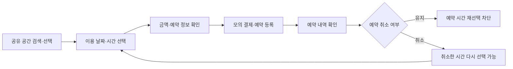

<h1 align="center">🏢 SPACE HUB — 공유 공간 대여 시스템</h1>

  
  
  

  공유 오피스 · 회의실 · 공유 주방 
  공유 공간 탐색부터 시간 선택, 모의 예약과 내역 관리까지

<h2>📌 프로젝트 개요</h2>

<strong>C#과 Windows Forms로 만든 공유 공간 예약 프로그램입니다.</strong> 
공유 오피스, 회의실, 공유 주방을 검색하고 이용할 시간을 선택해 예약할 수 있습니다.

공유 공간 탐색부터 이용 시간 선택, 금액 확인, 예약 등록과 취소까지 예약 흐름을 관리할 수 있도록 프로그램을 구현했습니다. 샘플 공유 공간 5개를 제공하며, 예약 상태와 누적 예약 건수를 화면에서 확인할 수 있습니다.

<table>
  <tr><th>항목</th><th>내용</th></tr>
  <tr><td>개발 환경</td><td>Windows, Visual Studio</td></tr>
  <tr><td>사용 언어</td><td>C#</td></tr>
  <tr><td>프레임워크</td><td>.NET 6, Windows Forms</td></tr>
  <tr><td>데이터 처리</td><td><code>List&lt;T&gt;</code> 기반 메모리 관리, LINQ 검색·필터</td></tr>
  <tr><td>화면 구성</td><td>Panel, FlowLayoutPanel, DataGridView, DateTimePicker</td></tr>
</table>

 

<h2>✨ 주요 기능</h2>

<table>
  <tr><th>기능</th><th>설명</th></tr>
  <tr><td><strong>공유 공간 탐색</strong></td><td>공유 공간명, 설명, 편의시설, 최대 인원, 시간당 금액 확인</td></tr>
  <tr><td><strong>검색·필터</strong></td><td>공유 공간명·설명 검색과 카테고리·이용 인원 조건을 함께 적용</td></tr>
  <tr><td><strong>찜</strong></td><td>공유 공간별 찜 등록·해제 및 찜한 공유 공간 수 표시</td></tr>
  <tr><td><strong>시간 선택</strong></td><td>09:00~20:00 중 여러 시간을 선택하고 예약 불가 시간 구분</td></tr>
  <tr><td><strong>금액 계산</strong></td><td>선택한 시간 수 × 공유 공간의 시간당 금액으로 총액 자동 계산</td></tr>
  <tr><td><strong>모의 결제</strong></td><td>카카오페이·토스페이·카드 중 결제 수단을 선택해 예약 등록</td></tr>
  <tr><td><strong>예약 관리</strong></td><td>예약자, 공유 공간, 날짜, 시간, 결제 수단, 금액 조회 및 예약 취소</td></tr>
  <tr><td><strong>후기</strong></td><td>공유 공간별 후기 조회와 1~5점 별점·후기 작성</td></tr>
  <tr><td><strong>화면 설정</strong></td><td>라이트 모드와 다크 모드 전환</td></tr>
</table>

 

<h2>⚙️ 핵심 구현</h2>

<h3>검색 조건을 조합한 공유 공간 필터링</h3>

카테고리, 검색어, 이용 인원 조건을 LINQ의 <code>Where</code> 조건으로 조합했습니다. 사용자가 조건을 바꿀 때마다 공유 공간 목록을 다시 구성해 모든 조건에 맞는 공유 공간만 보여줍니다.

<h3>선택 시간에 따른 금액 계산</h3>

선택한 시간을 <code>List&lt;int&gt;</code>로 관리합니다. 시간 버튼을 누르면 목록에 시간을 추가하거나 제거하고, 선택된 시간의 개수와 시간당 금액을 곱해 총 결제 금액을 갱신합니다.

<pre><code>총 결제 금액 = 선택한 시간 수 × 공유 공간별 시간당 금액</code></pre>

<h3>예약과 취소 상태 연결</h3>

예약이 완료되면 선택한 시간을 해당 공유 공간의 예약 시간 목록에 추가합니다. 예약 취소 시에는 같은 시간을 목록에서 제거해 다시 선택할 수 있도록 했습니다. 예약 내역은 <code>DataGridView</code>를 이용해 표 형태로 확인할 수 있습니다.

<h3>코드에서 동적으로 생성한 화면</h3>

공유 공간 카드, 시간 버튼, 후기 목록처럼 반복되는 화면 요소를 코드에서 동적으로 생성했습니다. 공유 공간이나 시간 데이터가 바뀌면 같은 생성 로직을 이용해 화면을 다시 구성합니다.

 

<h2>🖥️ 실행 화면</h2>

<h3>01. 공유 공간 탐색 및 시간 선택</h3>

  

<strong>하얀색은 선택 가능한 시간</strong>, <strong>회색은 이미 예약된 시간</strong>, <strong>파란색은 선택한 시간</strong>입니다. 하얀색 표시는 라이트 모드 기준입니다. 선택한 시간에 따라 총액이 자동으로 바뀝니다.

<h3>누적 예약 건수 확대 표시</h3>

누적 예약 건수를 별도 영역으로 분리하고 <strong>40pt 굵은 숫자</strong>로 확대했습니다. 이번 실행 중 완료한 예약을 누적 집계하며, 예약을 취소해도 누적 건수는 유지합니다. 현재 유효한 예약 건수는 따로 표시합니다. 아래는 예약 2회 중 1회를 취소한 테스트 화면입니다.

<h3>02. 모의 결제</h3>

  

선택한 공유 공간과 날짜, 시간, 금액을 확인한 뒤 결제 수단을 선택합니다. <strong>실제 결제는 진행되지 않습니다.</strong>

 

<h2>🔧 구현하면서 해결한 문제</h2>

<h3>예약된 시간을 알아보기 어려웠던 문제</h3>

<table>
  <tr><th>구분</th><th>내용</th></tr>
  <tr><td><strong>문제</strong></td><td>이미 예약된 시간과 예약 가능한 시간을 화면에서 바로 구분하기 어려웠습니다.</td></tr>
  <tr><td><strong>해결</strong></td><td>예약된 시간 버튼은 회색으로 표시하고 <code>Enabled = false</code>를 적용해 재선택할 수 없도록 구현하였습니다. 선택 가능한 시간은 하얀색, 사용자가 선택한 시간은 파란색으로 표시했습니다. 예약 확정 시에도 중복 여부를 다시 확인합니다.</td></tr>
  <tr><td><strong>결과</strong></td><td>예약 전에 이용 가능한 시간을 바로 확인할 수 있으며, 예약 취소 시 해당 시간을 다시 선택할 수 있게 했습니다.</td></tr>
</table>

 

<h2>🔄 사용 흐름</h2>

사용 흐름을 그림으로 한눈에 확인할 수 있도록 정리했습니다.

날짜는 예약 정보로 저장하며, 현재 예약 가능 시간의 중복 여부는 공유 공간별로 관리합니다.

<ol>
  <li>카테고리, 검색어, 인원 조건으로 원하는 공유 공간을 찾습니다.</li>
  <li>공유 공간을 선택하고 예약자 정보와 이용 날짜를 입력합니다.</li>
  <li>하얀색으로 표시된 선택 가능한 시간 중 원하는 시간을 선택합니다.</li>
  <li>자동 계산된 금액을 확인하고 모의 결제 수단을 선택합니다.</li>
  <li>등록된 예약은 예약 관리 화면에서 조회하거나 취소합니다.</li>
</ol>

 

<h2>🗂️ 프로젝트 구조</h2>

<pre><code>WinFormsApp1/
├── WinFormsApp1.sln       # Visual Studio 솔루션
├── WinFormsApp1.csproj    # .NET 및 Windows Forms 설정
├── Program.cs             # 프로그램 시작 지점
├── Form1.cs               # 화면 구성과 검색·예약·후기 처리
├── Form1.Designer.cs      # 기본 폼 디자이너 코드
└── Form1.resx             # 폼 리소스</code></pre>

 

<h2>🚀 실행 방법</h2>

Windows 환경에서 .NET 6 대상 Windows Forms 프로젝트를 빌드할 수 있는 개발 환경이 필요합니다.

<ol>
  <li>Visual Studio에서 <code>WinFormsApp1.sln</code>을 엽니다.</li>
  <li><code>.NET 데스크톱 개발</code> 구성 요소가 설치되어 있는지 확인합니다.</li>
  <li><code>F5</code>를 눌러 실행합니다.</li>
</ol>

 

<h2>📝 참고 사항</h2>

<ul>
  <li>샘플 공유 공간 5개를 사용하며, 실제 결제 서비스와는 연결되어 있지 않습니다.</li>
  <li>예약·누적 예약 건수·찜·후기는 메모리에 저장되므로 <strong>프로그램을 종료하면 초기화됩니다.</strong></li>
  <li>예약 가능 시간은 현재 공유 공간별로 관리하며, <strong>날짜별로 구분하는 기능은 구현하지 않았습니다.</strong></li>
</ul>

<h2>🌱 향후 개선 사항</h2>

<ul>
  <li>날짜별 예약 가능 시간 관리</li>
  <li>이름·전화번호 형식 및 과거 날짜 입력 검증</li>
  <li>데이터베이스를 이용한 예약·찜·후기 저장</li>
  <li>로그인과 사용자별 예약 내역 관리</li>
  <li>실제 결제 API 연동</li>
</ul>

